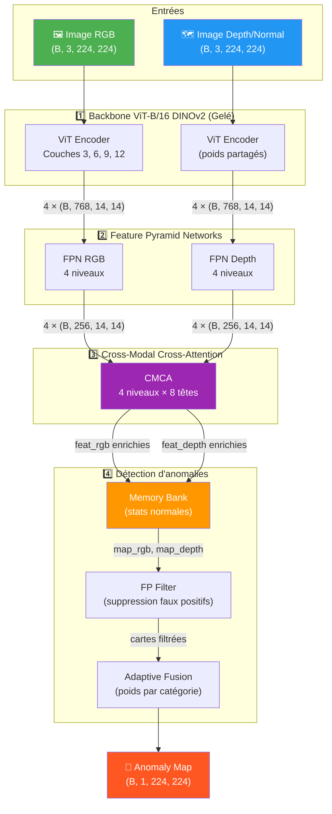
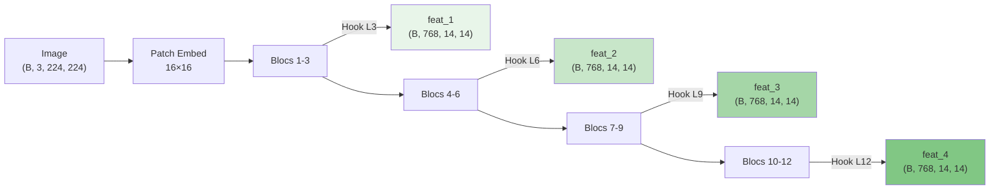
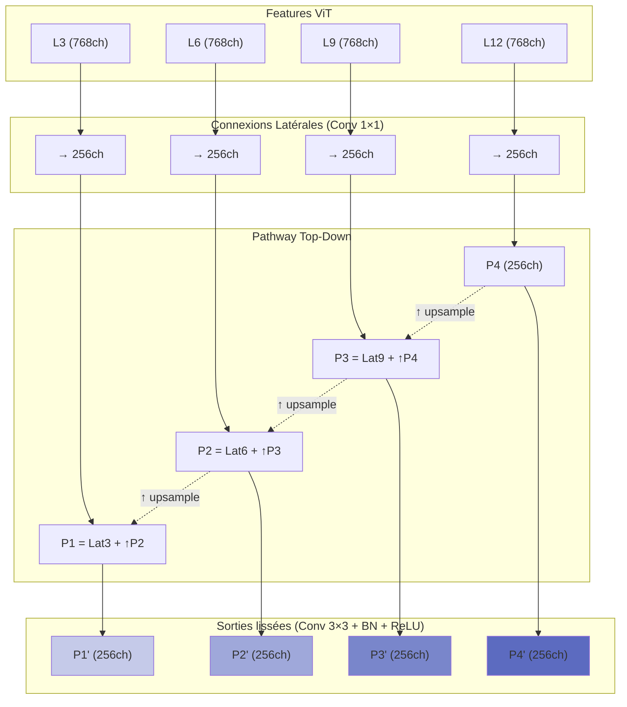
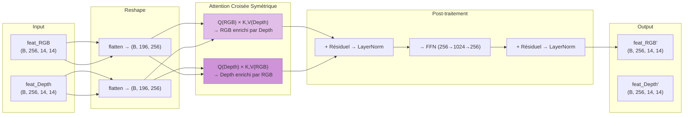
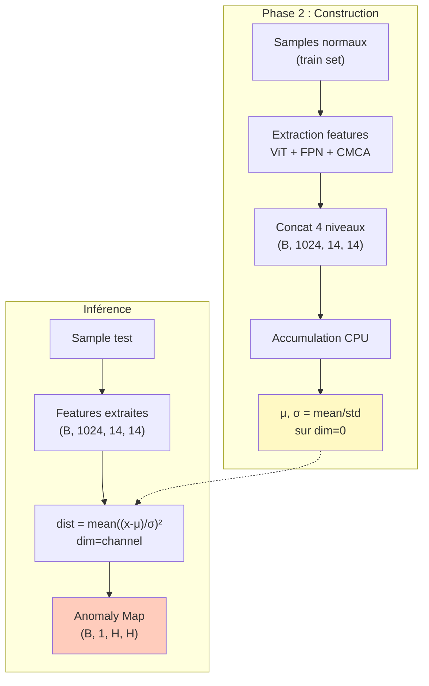
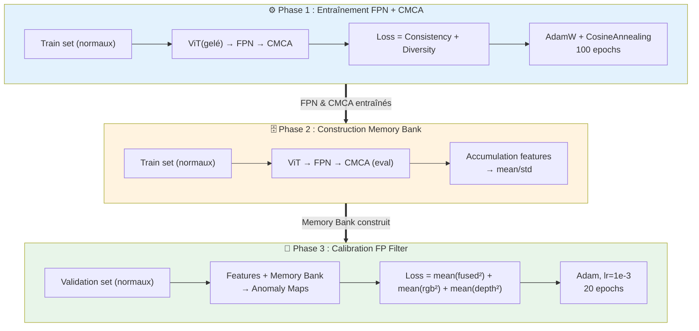
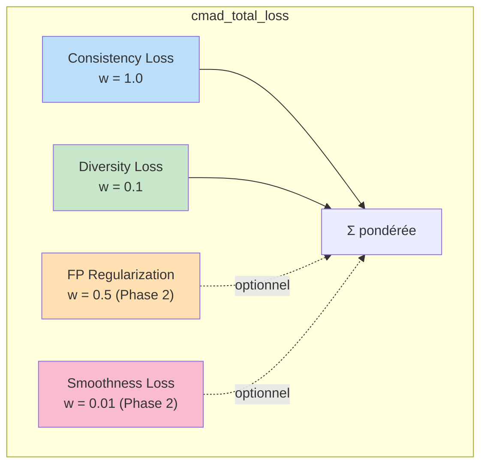
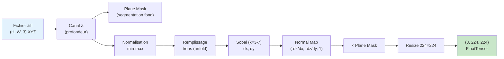
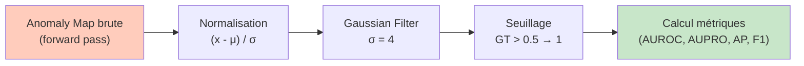
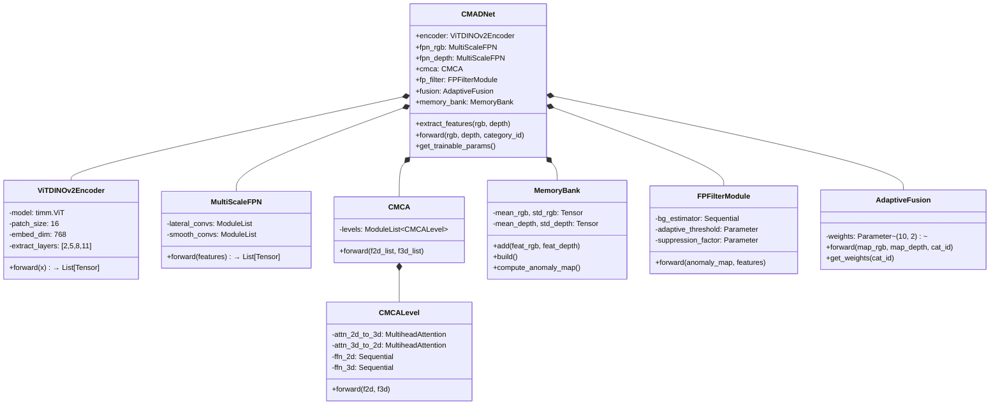

# 🏗️ Architecture du Projet CMAD-Net

> **Cross-Modal Attention Detection Network** — Réseau de détection d'anomalies 3D multi-modale basé sur l'attention croisée entre les modalités RGB et Profondeur (Depth).

---

## 📁 Arborescence du Projet

```
CMD-sb/
├── train_cmad.py                  # Script principal d'entraînement (3 phases)
├── requirements.txt               # Dépendances Python
│
├── models/                        # 🧠 Architecture du réseau
│   ├── __init__.py                # Exports du package
│   ├── vit_encoder.py             # Backbone ViT-B/16 DINOv2 (gelé)
│   ├── fpn.py                     # Feature Pyramid Network multi-échelles
│   ├── cmca.py                    # Cross-Modal Cross-Attention (module central)
│   ├── fp_filter.py               # False Positive Filter Module
│   ├── fusion.py                  # Adaptive Score Fusion par catégorie
│   └── cmad_net.py                # Assemblage complet + MemoryBank
│
├── dataset/                       # 📦 Chargement des données
│   ├── __init__.py
│   ├── dataset_cmad.py            # Dataset MVTec 3D-AD pour CMAD-Net
│   ├── geo_utils.py               # Utilitaires géométriques (depth → normals)
│   └── mvtec3d_utils.py           # Constantes MVTec 3D-AD
│
├── utils/                         # 🔧 Utilitaires
│   ├── __init__.py
│   └── losses.py                  # Fonctions de loss (consistency, diversity, etc.)
│
├── evaluation/                    # 📊 Évaluation
│   ├── __init__.py
│   ├── eval_utils.py              # Calcul de cartes d'anomalies + PRO
│   └── metrics_utils.py           # AUPRO officiel MVTec 3D-AD
│
├── data/                          # 📂 Données MVTec 3D-AD (10 catégories)
│   ├── bagel/
│   ├── cable_gland/
│   ├── carrot/
│   ├── cookie/
│   ├── dowel/
│   ├── foam/
│   ├── peach/
│   ├── potato/
│   ├── rope/
│   └── tire/
│
└── logs/                          # 📝 Logs et checkpoints
    ├── checkpoints/               # Poids sauvegardés (.pth)
    └── cmad_net_mvtec3d_seed42.txt
```

---

## 🏛️ Architecture Globale du Modèle



---

## 🔍 Description Détaillée des Modules

### 1️⃣ ViT-B/16 DINOv2 Encoder — [vit_encoder.py](file:///Users/souhaibchettou/Downloads/CMAD-Net/models/vit_encoder.py)

| Propriété | Valeur |
|-----------|--------|
| Modèle | `vit_base_patch16_224.dino` (via `timm`) |
| Patch size | 16 × 16 |
| Embed dim | 768 |
| Résolution spatiale | 14 × 14 (224 / 16) |
| Couches extraites | L3, L6, L9, L12 (indices 2, 5, 8, 11) |
| Paramètres | **Tous gelés** (backbone teacher) |
| Partage | **Poids partagés** entre RGB et Depth |

**Fonctionnement** :
- Forward hooks enregistrés sur les blocs Transformer pour capturer les features intermédiaires
- Le CLS token est retiré, les patch tokens sont reshapés en feature maps 2D : `(B, N, 768)` → `(B, 768, 14, 14)`
- Le mode `eval()` est forcé en permanence (override de `train()`)



---

### 2️⃣ Multi-Scale FPN — [fpn.py](file:///Users/souhaibchettou/Downloads/CMAD-Net/models/fpn.py)

> Feature Pyramid Network à 4 niveaux avec pathway top-down. Un FPN **séparé** pour chaque modalité (RGB et Depth).

| Propriété | Valeur |
|-----------|--------|
| Entrée | 4 × `(B, 768, 14, 14)` |
| Sortie | 4 × `(B, 256, 14, 14)` |
| Connexions latérales | Conv 1×1 (768 → 256) |
| Lissage | Conv 3×3 + BatchNorm + ReLU |

**Architecture interne** :



---

### 3️⃣ Cross-Modal Cross-Attention (CMCA) — [cmca.py](file:///Users/souhaibchettou/Downloads/CMAD-Net/models/cmca.py)

> **Module central** de CMAD-Net. Attention croisée symétrique entre les features RGB et Depth.

| Propriété | Valeur |
|-----------|--------|
| Dimension | 256 |
| Nombre de têtes | 8 |
| Niveaux | 4 (un par niveau FPN) |
| Dropout | 0.1 |

**Mécanisme par niveau** (classe [CMCALevel](file:///Users/souhaibchettou/Downloads/CMAD-Net/models/cmca.py#L16-L94)) :



**Flux détaillé** :
1. **Reshape spatial → séquence** : `(B, C, H, W)` → `(B, H×W, C)` = `(B, 196, 256)`
2. **Attention croisée 2D→3D** : `Q=RGB, K=V=Depth` → RGB enrichi par les informations 3D
3. **Attention croisée 3D→2D** : `Q=Depth, K=V=RGB` → Depth enrichi par les informations 2D
4. **Résiduel + LayerNorm** après chaque attention
5. **FFN** (256 → 1024 → 256) avec GELU + Dropout
6. **Résiduel + LayerNorm** final
7. **Reshape séquence → spatial** : `(B, 196, 256)` → `(B, 256, 14, 14)`

---

### 4️⃣ Memory Bank — [cmad_net.py](file:///Users/souhaibchettou/Downloads/CMAD-Net/models/cmad_net.py#L25-L104)

> Composant **non-paramétrique** qui stocke les statistiques (mean, std) des features normales pour détecter les anomalies par distance.

| Propriété | Valeur |
|-----------|--------|
| Type | Statistique (non-paramétrique) |
| Stockage | Mean et Std des features concaténées |
| Distance | Pseudo-Mahalanobis normalisée |
| Construction | Phase 2 de l'entraînement |

**Processus** :
1. **Ajout** (`add`) : concaténation des 4 niveaux FPN → `(B, 1024, 14, 14)` stocké en CPU
2. **Construction** (`build`) : calcul de `mean` et `std` sur tous les échantillons normaux
3. **Inférence** (`compute_anomaly_map`) : distance normalisée `((x - μ) / σ)²` moyennée sur les canaux



---

### 5️⃣ FP Filter Module — [fp_filter.py](file:///Users/souhaibchettou/Downloads/CMAD-Net/models/fp_filter.py)

> Calibre la carte d'anomalies pour supprimer les **faux positifs** en apprenant un masque de régions "naturellement actives".

| Propriété | Valeur |
|-----------|--------|
| Entrée features | `(B, 1024, H, W)` (4 niveaux FPN concaténés) |
| Entrée anomaly map | `(B, 1, H, W)` |
| Sortie | `(B, 1, H, W)` filtrée |
| Paramètres apprenables | `adaptive_threshold` (init 0.5), `suppression_factor` (init 0.3) |

**Architecture** :

```
bg_estimator:
  Conv2d(1024, 128, 3×3) → BN → ReLU
  Conv2d(128, 64, 3×3)   → BN → ReLU  
  Conv2d(64, 1, 1×1)     → Sigmoid
```

**Formule de filtrage** :
```
bg_score = bg_estimator(features)                   # ∈ [0, 1]
filtered = anomaly_map × (1 - supp × bg_score)      # Suppression du fond
filtered = ReLU(filtered - offset) + offset          # Seuillage adaptatif
```

---

### 6️⃣ Adaptive Score Fusion — [fusion.py](file:///Users/souhaibchettou/Downloads/CMAD-Net/models/fusion.py)

> Fusionne les cartes d'anomalies RGB et Depth avec des poids **appris par catégorie**.

| Propriété | Valeur |
|-----------|--------|
| Catégories | 10 (MVTec 3D-AD) |
| Poids | `(10, 2)` — un couple `[w_rgb, w_depth]` par catégorie |
| Normalisation | Softmax sur dim=-1 |

**Formule** :
```
w = softmax(weights[category_id])     # [w_rgb, w_depth], somme = 1
fused = w_rgb × map_rgb + w_depth × map_depth
```

---

## 📐 Pipeline d'Entraînement en 3 Phases



### Détail des phases

| Phase | Modules entraînés | Modules gelés | Données | Loss | Optimizer | Epochs |
|-------|-------------------|---------------|---------|------|-----------|--------|
| **1** | FPN_rgb, FPN_depth, CMCA | ViT, FP Filter, Fusion | Train (normaux) | Consistency (w=1.0) + Diversity (w=0.1) | AdamW (lr=1e-4, wd=1e-4) | 100 |
| **2** | — (pas d'entraînement) | Tout | Train (normaux) | — | — | — |
| **3** | FP Filter, Fusion | ViT, FPN, CMCA | Validation (normaux) | ‖fused‖² + ‖rgb‖² + ‖depth‖² | Adam (lr=1e-3) | 20 |

---

## 📉 Fonctions de Loss — [losses.py](file:///Users/souhaibchettou/Downloads/CMAD-Net/utils/losses.py)



| Loss | Formule | Rôle |
|------|---------|------|
| **Consistency** | `1 - cosine_sim(feat_rgb, feat_depth)`, moyennée par pixel et par niveau | Aligner les features RGB/Depth pour les samples normaux |
| **Diversity** | `‖F_norm_i^T × F_norm_j‖²` entre niveaux FPN | Décorreler les niveaux FPN (anti-redondance) |
| **FP Regularization** | `mean(anomaly_map²)` | Minimiser les scores sur les normaux (Phase 3) |
| **Smoothness** | `‖∂x‖² + ‖∂y‖²` (variations spatiales) | Lisser la carte d'anomalies |

---

## 📦 Dataset — [dataset_cmad.py](file:///Users/souhaibchettou/Downloads/CMAD-Net/dataset/dataset_cmad.py)

### Format de données MVTec 3D-AD

```
data/{category}/
├── train/
│   └── good/
│       ├── rgb/         # Images PNG (RGB)
│       └── xyz/         # Fichiers TIFF (nuage de points XYZ)
├── validation/
│   └── good/
└── test/
    ├── good/
    │   ├── rgb/
    │   ├── xyz/
    │   └── gt/          # Ground truth masks (PNG)
    ├── contamination/
    ├── crack/
    ├── hole/
    └── ...
```

### Traitement Depth → Normal Map



### Transforms appliquées

| Type | Train | Test |
|------|-------|------|
| **RGB** | Resize(224) → ToTensor → Normalize(ImageNet) | Resize(224) → ToTensor → Normalize(ImageNet) |
| **Depth/Normal** | Resize(224) → Normalize(ImageNet) | Resize(224) → Normalize(ImageNet) |
| **Ground Truth** | — | Resize(224) → ToTensor |

### Kernel Sobel par catégorie

| Catégorie | Kernel k |
|-----------|----------|
| cookie | 3 |
| dowel, foam, tire | 7 |
| Toutes les autres | 5 (défaut) |

---

## 📊 Pipeline d'Évaluation

### Métriques calculées

| Métrique | Niveau | Description |
|----------|--------|-------------|
| **I-AUROC** | Image | Area Under ROC Curve (classification d'images) |
| **P-AUROC** | Pixel | Area Under ROC Curve (segmentation pixel) |
| **AUPRO@30%** | Pixel | Area Under PRO Curve (FPR ≤ 30%) |
| **AUPRO@10%** | Pixel | Area Under PRO Curve (FPR ≤ 10%) |
| **AUPRO@5%** | Pixel | Area Under PRO Curve (FPR ≤ 5%) |
| **AUPRO@1%** | Pixel | Area Under PRO Curve (FPR ≤ 1%) |
| **I-AP** | Image | Average Precision (classification) |
| **P-AP** | Pixel | Average Precision (segmentation) |
| **I-F1** | Image | F1-Score max (classification) |
| **P-F1** | Pixel | F1-Score max (segmentation) |

### Post-traitement des cartes d'anomalies



---

## 🔗 Dépendances Clés

| Package | Version | Rôle |
|---------|---------|------|
| `torch` | ≥ 2.0.0 | Framework deep learning |
| `torchvision` | ≥ 0.15.1 | Transforms, modèles |
| `timm` | ≥ 0.9.0 | Modèles ViT pré-entraînés |
| `numpy` | ≥ 1.24.2 | Calcul numérique |
| `opencv-python` | ≥ 4.7.0 | Traitement d'images (Sobel, morphologie) |
| `scikit-learn` | ≥ 1.3.0 | Métriques (AUROC, AP) |
| `scikit-image` | ≥ 0.19.3 | Region props (PRO) |
| `tifffile` | ≥ 2023.2.0 | Lecture fichiers TIFF (depth maps) |
| `scipy` | ≥ 1.10.1 | Gaussian filter, connected components |
| `pandas` | ≥ 2.0.3 | Tableaux de métriques |

---

## 🧮 Résumé des Dimensions Tensorielles

```
Entrée RGB/Depth :           (B, 3, 224, 224)
                                    ↓
ViT Encoder (×4 couches) :  (B, 768, 14, 14) × 4
                                    ↓
FPN (×4 niveaux) :           (B, 256, 14, 14) × 4
                                    ↓
CMCA (×4 niveaux) :          (B, 256, 14, 14) × 4
                                    ↓
Concat niveaux :              (B, 1024, 14, 14)
                                    ↓
Memory Bank distance :        (B, 1, 14, 14)
                                    ↓
FP Filter :                   (B, 1, 14, 14)
                                    ↓
Upsample :                    (B, 1, 224, 224)
                                    ↓
Adaptive Fusion :             (B, 1, 224, 224)  ← sortie finale
```

---

## 🔄 Diagramme de Classes



---

## 🎯 10 Catégories MVTec 3D-AD

| Index | Catégorie | Sobel k |
|-------|-----------|---------|
| 0 | bagel | 5 |
| 1 | cable_gland | 5 |
| 2 | carrot | 5 |
| 3 | cookie | 3 |
| 4 | dowel | 7 |
| 5 | foam | 7 |
| 6 | peach | 5 |
| 7 | potato | 5 |
| 8 | rope | 5 |
| 9 | tire | 7 |

---

## ⚡ Configuration par Défaut

| Paramètre | Valeur (Local) | Valeur (Kaggle) |
|------------|----------------|-----------------|
| Learning rate | 1e-4 | 1e-4 |
| Batch size | 16 | 16 |
| Epochs Phase 1 | 100 | 50 |
| Epochs Phase 3 | 20 | 10 |
| Optimizer Phase 1 | AdamW (wd=1e-4) | AdamW (wd=1e-4) |
| Scheduler Phase 1 | CosineAnnealing | CosineAnnealing |
| Optimizer Phase 3 | Adam (lr=1e-3) | Adam (lr=1e-3) |
| Image size | 224 × 224 | 224 × 224 |
| Seed | 42 | 42 |
| Num workers | 4 | 2 |
